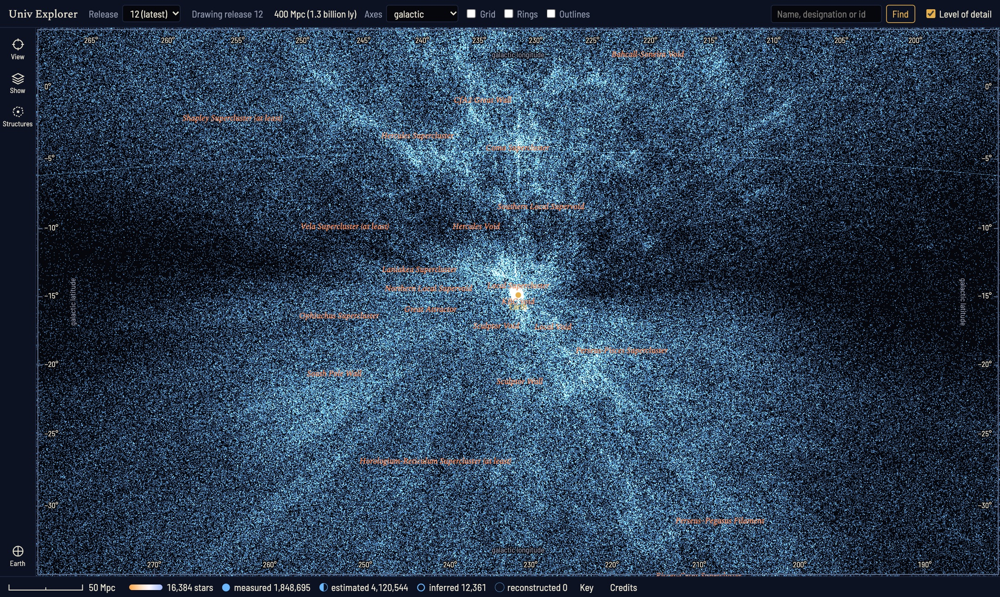
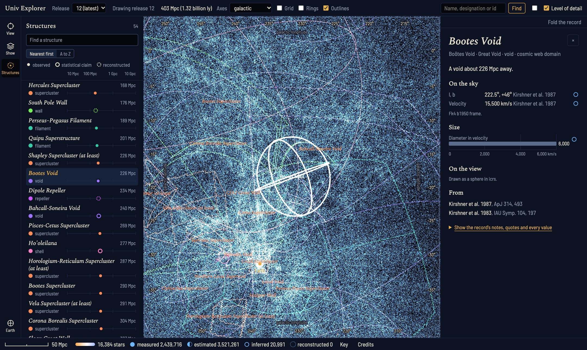
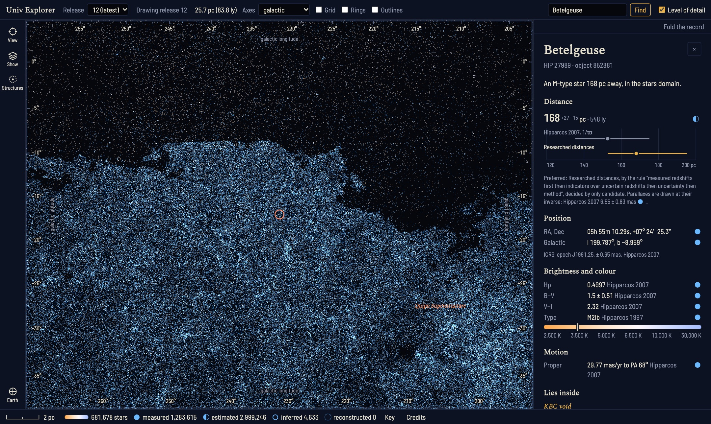
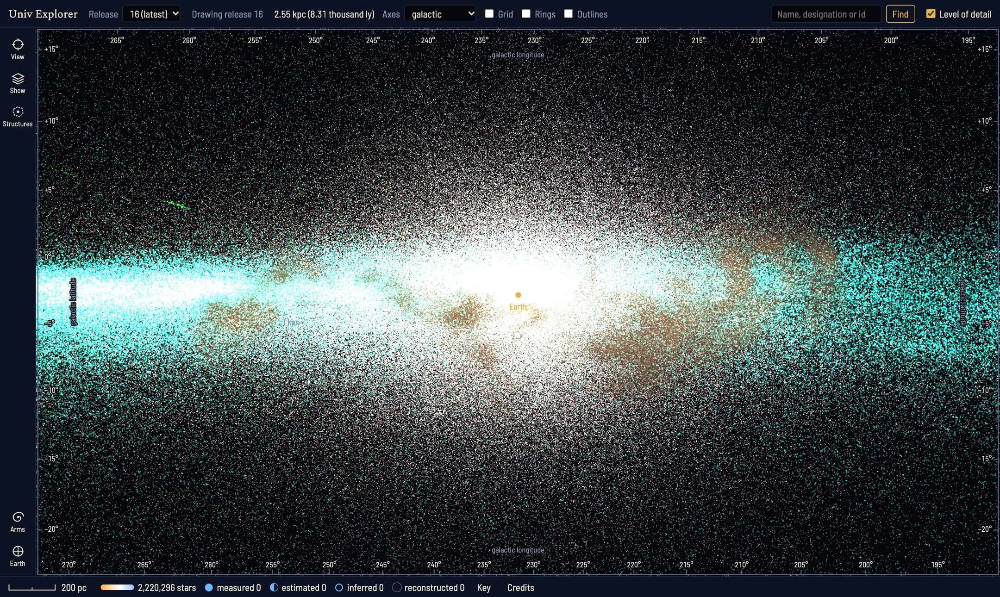
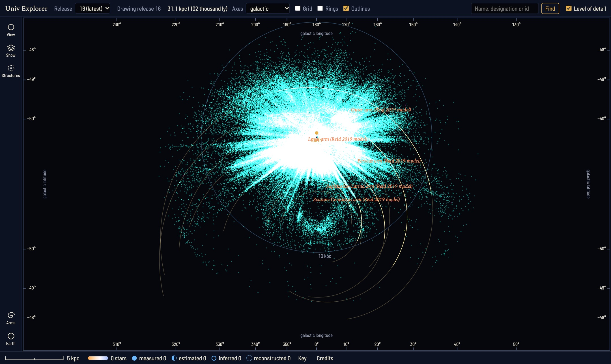

# Univ

Real astronomical and cosmological data, normalized, cross-matched and served, with a 3D explorer
that draws it around Earth: from the nearest stars out through the Local Group, the galaxy
surveys and the cosmic web, to structures billions of light years away.

Every value comes from a published catalogue or paper, with its citation. What was measured is
kept apart from what was estimated or reconstructed, and uncertainties are kept rather than
dropped.



*The cosmic web out to 400 Mpc (1.3 billion light years) around Earth: about six million galaxies,
quasars and clusters from the surveys, with the names of the large-scale structures. The dark band across the
middle is the zone of avoidance, where the Milky Way's own disc hides the sky behind it.*

## Built specification-first with Loft

This repository is built with [Loft](https://github.com/Ask-Loft/loft). The specification comes
first, and the code is held to it.

- **The specification is the contract.** `spec/` describes the three products, with their
  requirements, acceptance criteria, components and architecture decisions. It is published from
  `develop` and pinned by `loft.lock.json`; the current publish is sequence 10.
- **Behaviour changes in the specification first.** A change to `spec/` is checked and approved
  before any code is written for it. Then the code is built against it, and the tests prove it.
- **Every criterion is traced to tests.** `loft.trace.yaml` links each acceptance criterion to
  the tests that verify it. A test that changes after its link was accepted fails the
  gate until the link is reviewed again.
- **Every branch keeps a record.** `.yard/` holds each branch's Yard Log: its stages and tasks,
  the questions asked and the answers given, the decisions, review findings and gate results.
  It is committed with the work.
- **One gate.** `cargo xtask check` runs:
  - `fmt` and clippy (pedantic, with no `unwrap`, `panic` or `unsafe`);
  - a limit of 500 lines per Rust file;
  - the Rust tests and `cargo deny`;
  - `loft check`, `loft reconcile` and, on `develop`, `loft verify`;
  - the explorer's typecheck, tests and build.
- **End-to-end.** `cargo xtask integration` starts the Worker on fixture releases, then runs its
  end-to-end tests and the explorer's Playwright tests, which include accessibility checks.
- **No network in tests.** Tests read recorded provider answers.

`AGENTS.md` has the full list of commands and conventions.

## The three products

| Product | What it is | Where |
|---|---|---|
| **Univ Ingest** | A local command line tool. It downloads public sky data, normalizes each catalogue into one model, cross-matches the entries into objects with stable ids, lays them out as tiles, and publishes immutable, numbered releases. | `crates/univ-ingest` |
| **Univ Server** | A Cloudflare Worker that serves the releases (objects, structures and tiles) and the layers clients write on top of them, with API keys and rate limits. It runs locally under `wrangler dev` for now. | `crates/univ-server`, `crates/univ-api` |
| **Univ Explorer** | A WebGL2 web app that draws a release in 3D around Earth. You turn, zoom and fly with the mouse, read any object's record and how its distance was derived, and browse the large-scale structures. | `clients/explorer` |

`crates/univ-model` holds the domain model the three share. `clients/tile-decoder` is the
reference TypeScript decoder of the tile format.



*The Boötes Void, chosen from the depth index. The index lists the structures outward from Earth
on one distance axis, each marked as observed, a statistical claim or reconstructed. The record
gives the void's position, velocity and size as Kirshner et al. published them, with their frame.*



*Betelgeuse's record: the Hipparcos parallax distance beside the researched distances, with their
uncertainties and the rule that chose between them. Every value names its source.*



*The Milky Way's disc seen edge-on from 2.5 kpc away: 2.2 million stars, with the luminous
hot stars of Zari et al. 2021 in cyan along the plane, and the Edenhofer et al. 2024 3D
dust map in brown. The dust map is a reconstruction and reaches 1.25 kpc from the Sun.*



*The arms view looks down on the disc from the north Galactic pole. The points are the young
tracers: luminous hot stars in cyan, open clusters younger than 30 million years, and the masers. The lines
are the log-spiral arms that Reid et al. 2019 fitted to the masers, and they are labelled as a model.
The fainter lines continue each formula beyond the masers it was fitted to, and they are this
project's extrapolation. Most of the measured stars lie within about 5 kpc of the Sun.*

## The data

The repository holds the definitions of the data, not the data itself. Each source is a YAML file
in `sources/` that gives:

- how to fetch it and which cuts apply;
- the unit of each column and the field it maps to;
- the coordinate frame and epoch;
- the primary citation, the provider's terms, and the credit they require.

A release is built locally from those definitions. Downloads are kept outside the repository.

| Scale | Sources |
|---|---|
| Stars | Gaia DR3 (stars brighter than G = 14) and its Hipparcos-2 cross-match; the Gaia Catalogue of Nearby Stars; Hipparcos (ESA 1997, and van Leeuwen 2007); Bailer-Jones et al. 2021 distances; the IAU Catalog of Star Names |
| The Galaxy | Zari et al. 2021 luminous hot stars; Hunt & Reffert 2023 open clusters; Reid et al. 2019 maser parallaxes and spiral arm fits; Skowron et al. 2025 classical Cepheids; Li et al. 2023 RR Lyrae; Baumgardt & Vasiliev 2021 globular clusters; the Edenhofer et al. 2024 3D dust map |
| Nearby galaxies | McConnachie 2012; the Updated Nearby Galaxy Catalog (Karachentsev et al. 2013); OpenNGC |
| The cosmic web | 2MRS, 2M++ and 2MPZ; 6dFGS DR3; 2dFGRS; SDSS DR17 and the BOSS Great Wall region; DESI DR1; GAMA DR4; WISE × SuperCOSMOS; ALFALFA α.100; eRASS1 clusters; Cosmicflows-4 distances |
| Reconstructions | The CF4++ density and velocity fields, the Cosmicflows-4 basins of attraction, and the 2M++ density and velocity fields (Carrick et al. 2015) |

Beyond the catalogues, two hand-researched sets are read from papers:

- **Structures (`structures/`):** voids, walls, superclusters and arcs, such as the Boötes Void,
  the Local Void and the BOSS Great Wall. Each file cites its papers and says whether the
  structure is observed, a statistical claim, or reconstructed.
- **Star distances (`stars/`):** distances of named stars, each citing its papers.

The rules that turn all this into a release are in `rules/`:

- `matching.yaml`: cross-matching;
- `ranking.yaml`: which measurement is preferred;
- `designations.yaml`: names;
- `tiles.yaml`: the tile layout;
- `science-checks.yaml`: the cited checks each release must pass.

### Conventions

- **Cosmology:** distances derived from redshift use Planck 2018 unless a release names another.
  Every derived value records the steps and citations that produced it.
- **Frames:** galactic coordinates follow the Hipparcos catalogue (ESA 1997), and supergalactic
  coordinates follow Lahav et al. 2000.
- **Uncertainties:** a value published without an uncertainty is marked as having none reported,
  never as zero.

### Credit and terms

Anyone who uses a release must credit its sources as each provider asks. The credit lines are in
each `sources/<id>.yaml`. A source whose terms forbid redistribution is never published.

Gaia data are under CC BY-NC 3.0 IGO, so a release that includes Gaia is for non-commercial use.

## Running it

You need:

- Rust (stable);
- Node.js with pnpm 11;
- Wrangler, installed by `npm install` at the root.

```sh
npm install                      # Wrangler, which writes the local D1 and R2
cargo run -p univ-ingest -- help # fetch, normalize, match, tiles, build, publish, prune
```

`univ-ingest build` fetches every source, then builds the next release. `univ-ingest publish` puts
that release into the local D1 and R2 that the Worker reads. The full fetch downloads about 4.5
gigabytes, and some providers are slow.

Once a release is published, put an owner secret in `crates/univ-server/.dev.vars`, as
`OWNER_SECRET=...`. Git ignores that file. Then run:

```sh
cargo xtask explore
```

This starts Univ Server and the explorer together. Open http://127.0.0.1:5317/. The explorer's
own [README](clients/explorer/README.md) covers its controls and how to point it at another
server.

## Layout

| Path | What it holds |
|---|---|
| `spec/` | The Loft specification |
| `sources/`, `structures/`, `stars/`, `names/` | Source definitions and researched data, in YAML |
| `rules/` | Matching, ranking, designation, tile and science-check rules |
| `crates/` | `univ-model`, `univ-ingest`, `univ-api` and `univ-server` |
| `clients/` | `explorer` and `tile-decoder` |
| `xtask/` | The gate, integration runs, science checks, benchmarks and `explore` |
| `docs/screenshots/` | The screenshots above |
| `.yard/` | Each branch's Yard Log |
